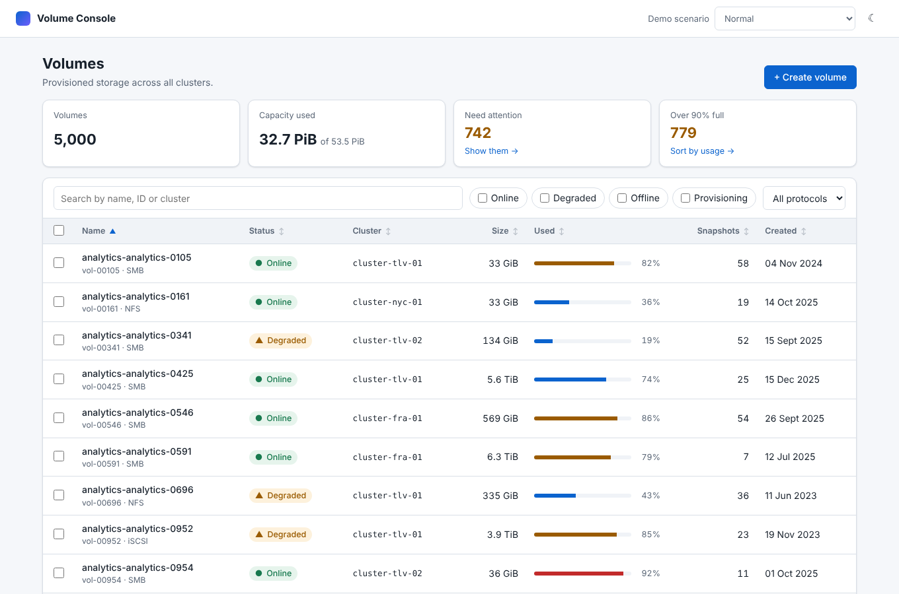
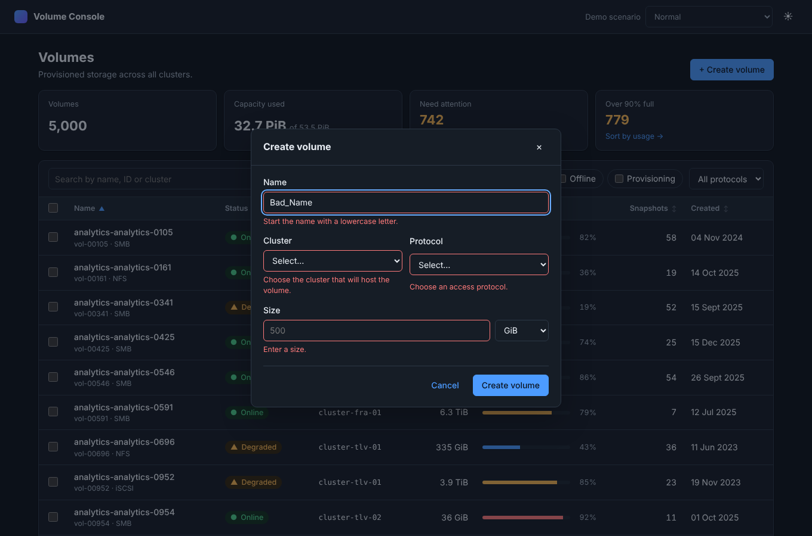
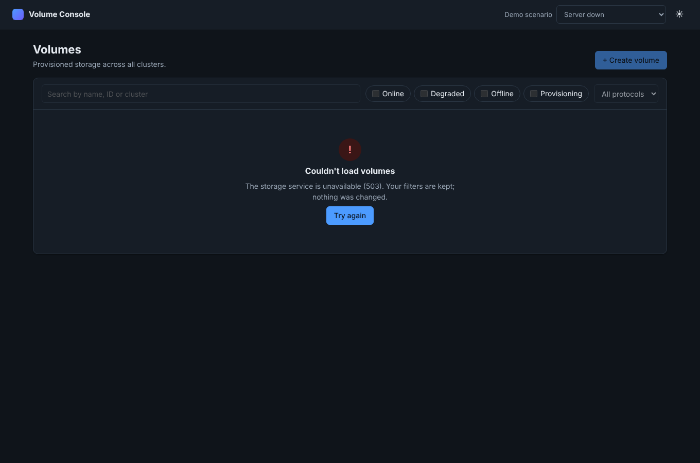

# Volume Console

An enterprise-style storage console built with **React 19 + TypeScript**: a 5,000-row volume table with search,
filters, sorting and pagination, a validated "create volume" form, bulk actions, and light/dark themes.

**Live demo:** https://yuvaltar.github.io/volume-console/

The project is about the parts of a data-heavy UI that static mockups usually skip: what the screen shows while
data loads, when the server fails, when an account is empty, when a filter matches nothing, and when half of a
bulk action fails. A **Demo scenario** menu in the top bar forces each of these states so they can be tried live.

| Light | Validation (dark theme) | Server error |
| --- | --- | --- |
|  |  |  |

## Features

- **Volume table**: sortable columns (`aria-sort`), debounced search, status and protocol filters, page sizes of
  10 to 100, and a page index that is clamped when filters shrink the result.
- **Summary cards** that act as shortcuts: "Need attention" filters to degraded and offline volumes, and "Over 90% full"
  sorts by usage.
- **Create volume** dialog: names, cluster, protocol and size (GiB or TiB) are validated with messages that say how
  to fix the problem. The size limits are shown in the unit the user chose, with a live preview of the provisioned size.
- **Bulk snapshots** run in parallel. On partial failure the app reports what succeeded and what failed, and keeps only
  the failed rows selected so a retry is one click.
- **Themes**: light and dark, built on CSS custom properties (design tokens). The default follows the OS setting and the
  choice is remembered.

## Every state, not only the happy path

| Situation | What the user sees |
| --- | --- |
| Loading | Skeleton rows; controls disabled; screen readers hear "Loading volumes" |
| Server down | Error panel with the server's message and **Try again**; filters are kept |
| Brand-new account | "No volumes yet" with a **Create your first volume** call to action |
| Filters match nothing | "No volumes match these filters" with **Clear filters** (different from the empty account) |
| Slow network | Same UI, longer skeleton; a slow old response can never overwrite newer data |
| Create fails (409, timeout) | Banner inside the dialog; everything the user typed is kept |
| Bulk action partly fails | "2 snapshots taken, 2 failed", with the failed rows still selected |

## Accessibility

- Semantic table with row headers, a caption, and sort buttons inside the column headers.
- Status badges use an icon and a label as well as colour; capacity bars are `role="meter"` with a readable label.
- Form errors are linked with `aria-describedby` and `aria-invalid`. On submit, focus moves to the first invalid field.
  Errors appear only after the first submit attempt, so the user isn't warned while still typing.
- Native `<dialog>` (focus trap, Esc, focus returned to the opener), a skip link, visible focus rings, live regions for
  result counts and toasts, and `prefers-reduced-motion` support.

## Structure

```
src/
  api/          mock REST API (deterministic 5,000-volume dataset, latency, failure scenarios)
  lib/          pure logic: filtering, sorting, pagination, capacity formatting, form validation
  hooks/        data loading with stale-response protection, debounce, theme
  components/   design-system primitives (Button, StatusBadge, CapacityBar, Dialog, Field, StatePanel),
                VolumeTable, Pagination, CreateVolumeDialog
  App.tsx       page composition and state
```

## Run it

```bash
npm install
npm run dev        # http://localhost:5173
npm test           # 23 tests (Vitest + Testing Library)
npm run build
```

GitHub Actions type-checks, tests and builds every push, and deploys `main` to GitHub Pages.
